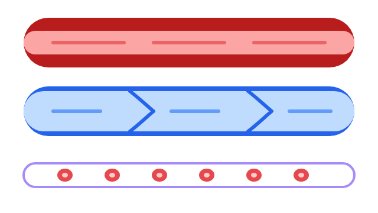

Каждую секунду сердце толкает кровь в сосуды, а сосуды доставляют её к каждой клетке тела. Вместе они образуют сердечно-сосудистую систему — транспортную сеть организма.

## Основные функции {#functions}

Сердечно-сосудистая система непрерывно движет кровь по организму. Благодаря этому:

- клетки получают кислород и питательные вещества;
- от тканей уносятся углекислый газ и другие продукты обмена;
- гормоны доставляются к органам, работой которых они управляют;
- тепло распределяется по телу, и температура остаётся постоянной;
- клетки иммунной системы быстро попадают туда, где нужна защита.

## Состав сердечно-сосудистой системы {#components}

Система состоит из двух частей.

**Сердце** — полый мышечный орган размером примерно с кулак. Оно работает как насос и толкает кровь в сосуды.

**Кровеносные сосуды** — сеть трубок, по которым течёт кровь:

- **артерии** несут кровь от сердца;
- **вены** возвращают кровь к сердцу;
- **капилляры** — самые тонкие сосуды, они соединяют артерии и вены.

В сосудах взрослого человека циркулирует около 5 литров крови.

## Строение сердца {#heart}

Сердце находится в грудной полости, немного левее середины. Внутри оно разделено на четыре камеры:

- два **предсердия** — правое и левое — принимают кровь из вен;
- два **желудочка** — правый и левый — выталкивают кровь в артерии.

Сплошная перегородка не даёт смешиваться крови правой и левой половин сердца. Между предсердиями и желудочками, а также на выходе из желудочков находятся **клапаны**. Они открываются только в одну сторону, поэтому кровь не течёт назад.

Стенка левого желудочка самая толстая: он гонит кровь по всему телу.

## Круги кровообращения {#circulation}

Кровь движется по двум замкнутым путям — кругам кровообращения.

**Малый (лёгочный) круг:** правый желудочек → лёгочная артерия → капилляры лёгких → лёгочные вены → левое предсердие. В лёгких кровь отдаёт углекислый газ и насыщается кислородом.

**Большой круг:** левый желудочек → аорта → артерии → капилляры органов → вены → полые вены → правое предсердие. В органах кровь отдаёт кислород и питательные вещества и забирает продукты обмена.

За один полный оборот кровь проходит через сердце дважды.

## Кровеносные сосуды и давление {#vessels-pressure}

У артерий толстые упругие стенки: они выдерживают высокое давление крови, которую выталкивает сердце. Стенки вен тоньше, а во многих венах рук и ног есть клапаны — они помогают крови подниматься к сердцу. Стенка капилляра состоит из одного слоя клеток, и через неё вещества переходят из крови в ткани и обратно.

**Кровяное давление** — сила, с которой кровь давит на стенки сосудов. Его измеряют тонометром и записывают двумя числами, например 120/80 мм рт. ст.: первое — давление в момент сокращения сердца, второе — в момент его расслабления. При физической нагрузке и волнении давление повышается, в покое — снижается.

**Пульс** — толчки стенки артерии при каждом сокращении сердца. У взрослого человека в покое — около 60–80 ударов в минуту.
