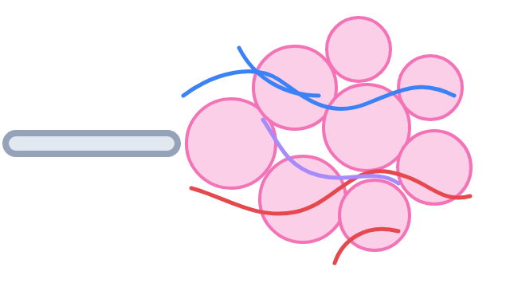

Адам тамақсыз бірнеше апта, сусыз бірнеше күн өмір сүре алады, ал ауасыз — бірнеше минут қана. Тыныс алу жүйесі ағзаны үздіксіз оттегімен қамтамасыз етеді.

## Тыныс алу не үшін қажет {#functions}

Жасушаларға үнемі энергия керек. Олар оны қоректік заттарды оттегінің көмегімен ыдырату арқылы алады. Бұл кезде ағзадан шығарылуы тиіс көмірқышқыл газы түзіледі.

Тыныс алу жүйесі:

- ауадағы оттегіні қанға жеткізеді;
- қаннан көмірқышқыл газын шығарады;
- жұтылған ауаны тазартады, жылытады және ылғалдандырады;
- дауыс шығаруға қатысады.

## Тыныс жолдары {#airways}

Ауа өкпеге түтіктер жүйесі — тыныс жолдары арқылы өтеді.

- **Мұрын қуысы.** Мұнда ауа жылынып, ылғалданып, тазарады: түктер мен шырыш шаң мен микробтарды ұстап қалады.
- **Көмей.** Онда дауыс байламдары орналасқан. Жұтынған кезде көмейдің кіреберісін **көмей қақпағы** жабады, сондықтан тамақ тыныс жолдарына түспейді.
- **Кеңірдек** — шеміршекті жартылай сақиналары бар түтік, олар оның қабысып қалуына жол бермейді.
- **Бронхтар.** Кеңірдек екі бронхқа бөлінеді, ал олар ағаштың бұтақтары сияқты барған сайын жіңішке бронхиолаларға тармақталады.

## Өкпе және альвеолалар {#lungs}

Өкпе — кеуде қуысындағы жұп мүше. Оң өкпе үш бөліктен, сол өкпе екі бөліктен тұрады: оның жанында жүрек орналасқан. Сыртынан өкпені жұқа қабық — плевра жабады.

Бронхиолалар кішкентай көпіршіктермен — **альвеолалармен** аяқталады. Альвеоланың қабырғасы бір қабат жасушадан тұрады және оны капиллярлар тығыз орап жатады. Ауадағы оттегі альвеола қабырғасы арқылы қанға, ал көмірқышқыл газы қаннан альвеолаға өтеді. Бұл процесс **газ алмасу** деп аталады.

## Дем алу және дем шығару {#breathing}

Өкпенің өзінде бұлшықет жоқ. Оны тыныс алу бұлшықеттері — **диафрагма** мен қабырғааралық бұлшықеттер созып, қысады.

- **Дем алу:** диафрагма жиырылып, төмен түседі, қабырғааралық бұлшықеттер қабырғаларды көтереді. Кеуде қуысының көлемі ұлғаяды, өкпе кеңейеді және оған ауа кіреді.
- **Дем шығару:** бұлшықеттер босаңсиды, кеуде қуысының көлемі кішірейеді және ауа сыртқа шығады.

Тыныштық күйде ересек адам минутына шамамен 16–18 рет дем алады. Жүгіргенде және жүзгенде тыныс жиілеп, тереңдейді.

## Тыныс алу гигиенасы {#hygiene}

- Мұрынмен дем ал: осылай ауа жақсы тазарады және жылынады.
- Бөлмені үнемі желдетіп, таза ауада жиі бол.
- Спортпен шұғылдан — бұл тыныс алу бұлшықеттерін жаттықтырады.
- Темекі шекпе және темекі түтінінен аулақ бол: ол альвеолалар мен бронхтарды зақымдайды.
- Жөтелгенде және түшкіргенде басқаларға жұқтырмас үшін аузың мен мұрныңды жап.
