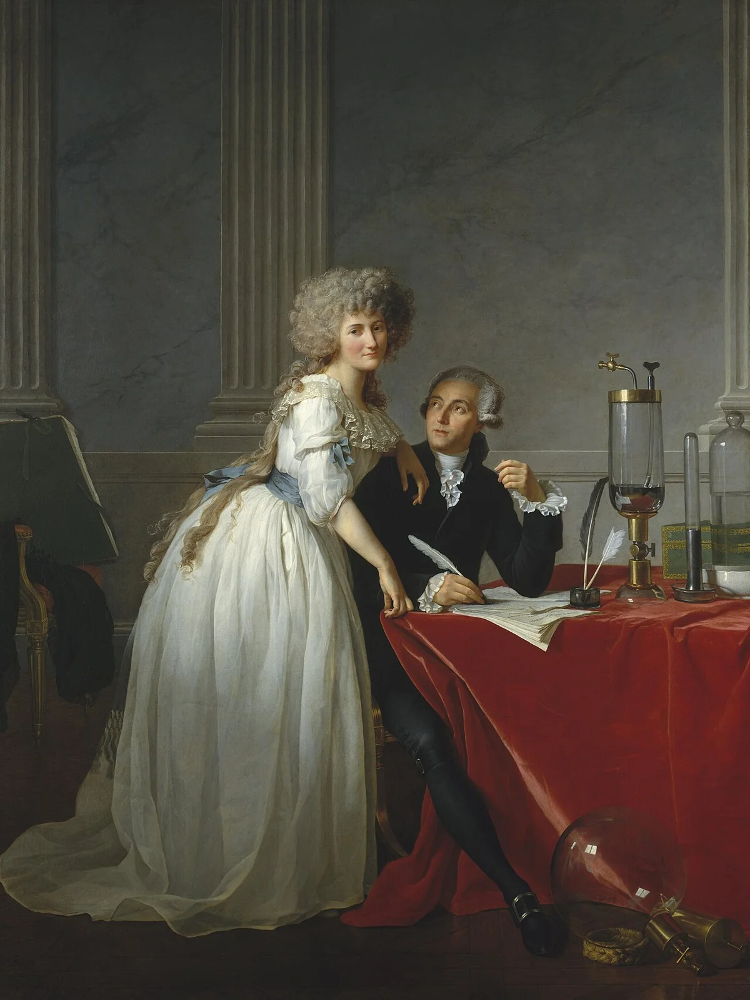
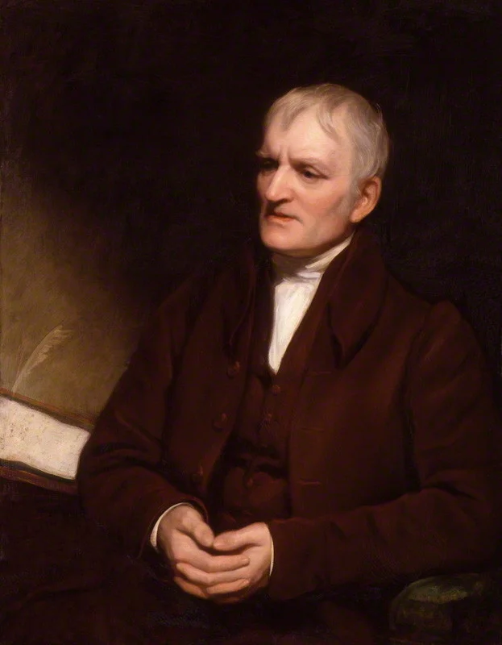
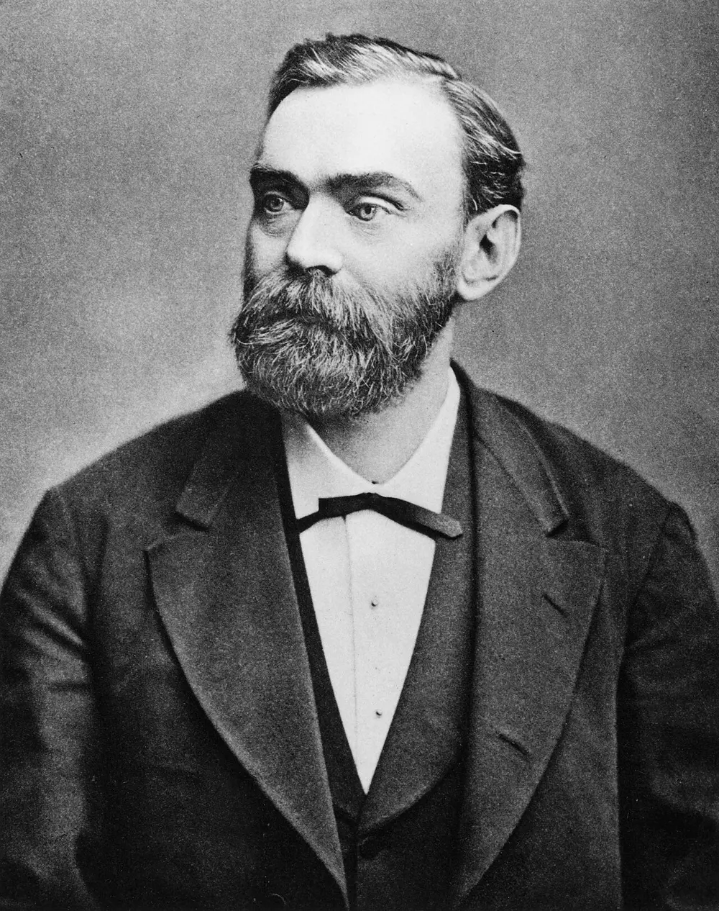
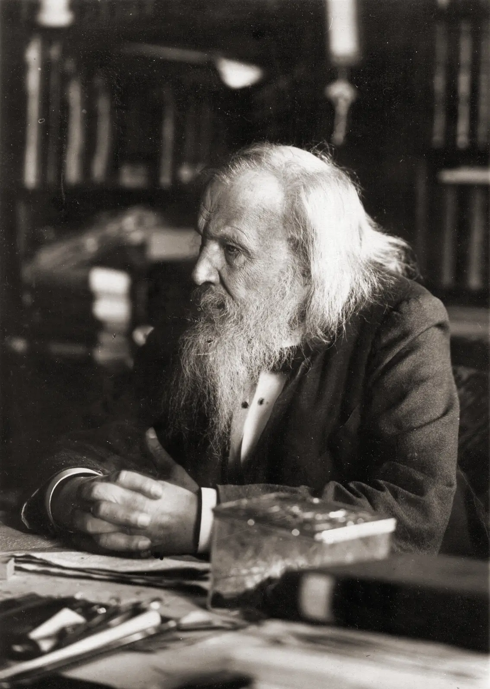
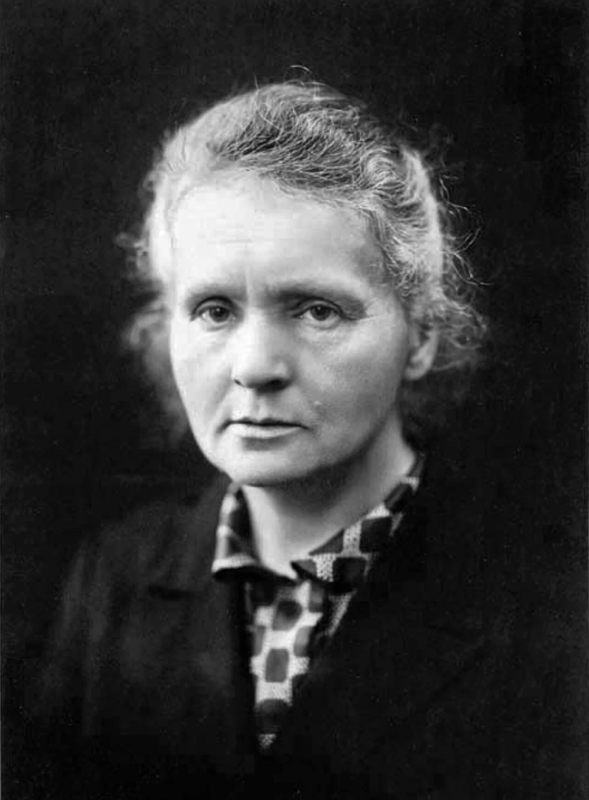
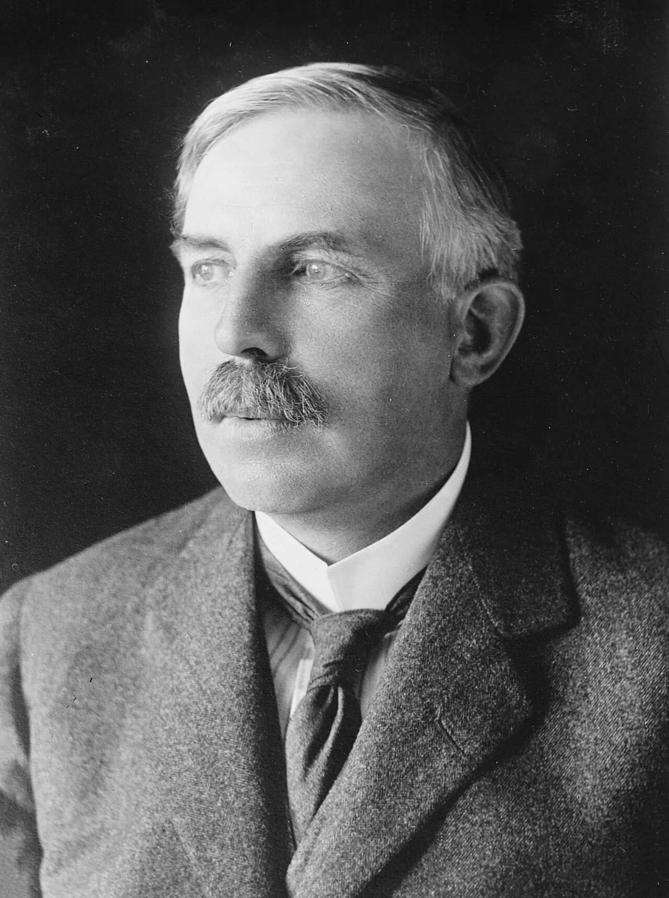
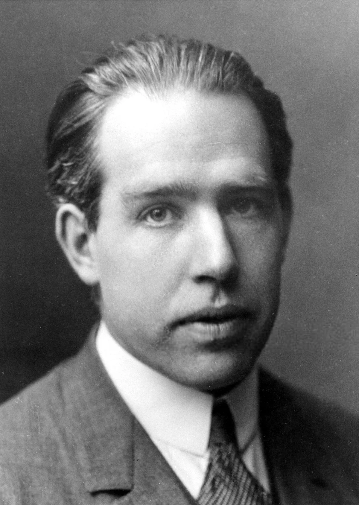
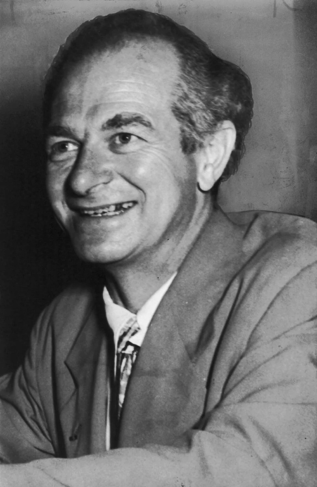

## Antoine Lavoisier {#lavoisier}

**"Father of modern chemistry," who turned it from a collection of experiments into an exact science.**

_The man who weighed the invisible_

> “Nothing is lost, nothing is created, everything is transformed.” _(attributed)_

### Father of Modern Chemistry

Antoine Lavoisier turned chemistry from a collection of alchemical mysteries into a precise science. He was the first to implement strict measurements and scales in every experiment.

### Conservation of Mass

Lavoisier proved that the total mass of substances does not change during chemical reactions. He also debunked the myth of "phlogiston" and explained that combustion is a reaction with oxygen.

**Nomenclature Revolution:** He created the system for naming chemical elements that we still use today, including Hydrogen and Oxygen.

### Interesting Facts

- **Water Revealed:** He was the first to prove that water is a compound made of hydrogen and oxygen, not a simple element.
- **Precision First:** Lavoisier believed that without mathematics, chemistry was just a collection of random observations.

**Fun fact:** Lavoisier proved that water consists of hydrogen and oxygen, and gave names to both elements.

## John Dalton {#dalton}

**Author of the modern atomic theory, which laid the foundation for understanding chemical elements.**

_Father of the Modern Atomic Theory_

> “Matter, though divisible in an extreme degree, is nevertheless not infinitely divisible.”

### The Atom Reborn

John Dalton brought back the idea that everything in the world is made of tiny, indivisible particles called atoms. He was the first to propose using atomic mass as the defining characteristic of elements.

### The Alphabet of Chemistry

Dalton created a system of symbols for elements and showed that chemical reactions are simply the rearrangement of atoms, which are neither created nor destroyed.

**Foundation:** Without Dalton's "building blocks," Mendeleev could not have constructed his great table sixty years later.

### Interesting Facts

- **Color Blindness:** He was the first to scientifically describe the vision defect where people cannot distinguish colors—now called Daltonism.
- **Humble Teacher:** Dalton worked his whole life as a modest mathematics teacher while making world-changing discoveries.

**Fun fact:** Dalton was the first to scientifically describe color blindness (daltonism), which he suffered from himself.

## Alfred Nobel {#nobel}

**Swedish chemist, engineer, and industrialist who invented dynamite and bequeathed his fortune to institute the Nobel Prizes.**

_The inventor of dynamite and founder of the Nobel Prize_

> “My dynamite will sooner lead to peace than a thousand world conventions.” _(attributed)_

### Who is Alfred Nobel?

Alfred Nobel was a Swedish chemist, engineer, and industrialist. Born in 1833 in Stockholm, he came from a family of engineers. Despite his later association with peace, his primary scientific contributions were in the field of explosives.

### The Invention of Dynamite

In 1867, Nobel made his most famous discovery. By mixing nitroglycerin with kieselguhr (a porous siliceous earth), he created a safer, more stable explosive. This invention revolutionized construction, mining, and demolition worldwide.

**The Nobel Legacy:** Deeply affected by a premature obituary that condemned him as the "merchant of death," Nobel left 94% of his massive fortune to establish the Nobel Prizes, honoring those who confer the "greatest benefit to humankind."

### Fascinating Facts

- **Prolific Inventor:** He held 355 different patents during his lifetime, ranging from explosives to synthetic materials.
- **Multilingual:** Nobel was fluent in Swedish, Russian, English, French, and German by the age of 17.

### Legacy

Today, Alfred Nobel is remembered not just as the inventor of dynamite, but as the visionary behind the world's most prestigious intellectual awards in Physics, Chemistry, Medicine, Literature, and Peace.

**Fun fact:** According to a popular story, Nobel created the Nobel Prizes after reading a premature obituary of himself titled "The merchant of death is dead".

## Dmitri Mendeleev {#mendeleev}

**Brilliant Russian chemist who discovered the Periodic Law and created the system that became the foundation of modern science.**

_The man who saw order in chaos_

### Who is Dmitri Mendeleev?

Dmitri Mendeleev was a brilliant Russian chemist and creator of the Periodic System. Born in 1834 in Tobolsk, Siberia, he was the youngest of 17 children. It was his mother who believed in his education, helping him reach Saint Petersburg.

### The Periodic Law

In 1869, Mendeleev revolutionized science by arranging elements by atomic mass and noticing that properties repeat at regular intervals. He turned chemical chaos into a coherent system.

**The Power of Prediction:** Mendeleev left empty spaces for undiscovered elements and accurately predicted their properties (Gallium, Scandium, Germanium) decades before they were found.

### Fascinating Facts

- **Beyond Chemistry:** He studied oil, meteorology, and even designed his own high-altitude balloons.
- **The Dream Legend:** While often told he saw the table in a dream, he famously said: "I thought about it for twenty years."

### Legacy

Without Mendeleev's system, modern medicine, pharmaceuticals and space research would be impossible. He showed that a pattern can be found in any chaos.

## Marie Curie {#curie}

**First woman to win a Nobel Prize, a researcher of radioactivity and discoverer of two new elements.**

_The woman who conquered radiation_

> “Nothing in life is to be feared, it is only to be understood.” _(attributed)_

### Researcher of Radioactivity

Marie Curie was the first woman to win a Nobel Prize and the only person to receive it in two different scientific fields (Physics and Chemistry). She discovered the elements Polonium and Radium.

### Scientific Courage

Marie worked under harsh conditions to isolate radioactive isotopes. She coined the term "radioactivity" and proved that atoms could be a source of immense internal energy.

**Legacy:** Her research paved the way for modern cancer treatments, nuclear power, and our understanding of the fundamental structure of matter.

### Interesting Facts

- **Mobile X-Rays:** During WWI, she developed mobile radiography units to help surgeons treat wounded soldiers.
- **Radioactive Notebooks:** Her laboratory notebooks are still radioactive today and are stored in lead-lined boxes.

**Fun fact:** Marie Curie was the first woman professor at the Sorbonne and an inspiring figure for women in STEM.

## Ernest Rutherford {#rutherford}

**Scientist who discovered the atomic nucleus and changed our understanding of the structure of matter.**

_Explorer of the Atomic Nucleus_

> “All science is either physics or stamp collecting.” _(attributed)_

### Discovery of the Nucleus

Ernest Rutherford was the man who discovered the "heart" of the atom. Through his famous gold foil experiment, he proved that almost all the mass of an atom is concentrated in a tiny, dense nucleus.

### Inside Matter

Before him, the atom was thought to be a solid sphere. Rutherford showed that the atom is 99% empty space, with a positively charged nucleus at its center.

**Father of Nuclear Physics:** His discoveries allowed humanity to understand the nature of radiation and begin utilizing atomic energy.

### Interesting Facts

- **Alpha and Beta:** He discovered and named alpha and beta radiation.
- **Modern Alchemy:** He was the first in the world to successfully transform one chemical element into another.

**Fun fact:** Rutherford discovered the atomic nucleus (1911) after he had already received the Nobel Prize (1908).

## Niels Bohr {#bohr}

**Creator of the quantum model of the atom, which explained the structure of electron shells and chemical periodicity.**

_Architect of the Atom_

> “An expert is a person who has made all the mistakes that can be made in a very narrow field.” _(attributed)_

### Quantum Breakthrough

Niels Bohr developed the first "planetary" model of the atom that explained how electron shells are organized. He realized that electrons move in strictly defined orbits.

### Energy Levels

Bohr proved that when electrons jump from one orbit to another, they emit or absorb discrete amounts of energy. This became the foundation of all modern physics and chemistry.

**Why it Matters:** His model explained why elements are positioned in specific groups in the Mendeleev table.

### Interesting Facts

- **Complementarity Principle:** He believed that complex things can only be understood by looking at them from different perspectives.
- **Nobel Legacy:** His son, Aage Bohr, also became a Nobel Prize winner in Physics.

**Fun fact:** Niels Bohr received the Nobel Prize for research into the structure of atoms and their radiation.

## Linus Pauling {#pauling}

**One of the greatest chemists of the 20th century, who explained the nature of chemical bonds and the structure of molecules.**

_Master of Chemical Bonds_

> “The best way to have a good idea is to have a lot of ideas.” _(attributed)_

### The Nature of the Bond

Linus Pauling explained to the world how atoms connect to each other. He combined quantum physics with chemistry to create the theory of the chemical bond.

### Electronegativity Scale

Pauling introduced the scale that shows how strongly an atom attracts electrons. This allowed chemists to predict which substances would be strong and which would be brittle.

**Two Prizes:** Pauling is the only person in history to win two unshared Nobel Prizes (Chemistry and Peace).

### Interesting Facts

- **The Structure of Life:** He was the first to describe protein structures (alpha-helix), which later helped in the discovery of DNA.
- **Vitamin C:** Later in life, he became a famous advocate for the health benefits of Vitamin C.

**Fun fact:** Linus Pauling is the only person in history to have received two undivided Nobel Prizes.

## Dorothy Hodgkin {#hodgkin}

**British chemist who won the 1964 Nobel Prize in Chemistry for determining the structures of important biomolecules (penicillin, vitamin B12).**

_Pioneer of X-ray Crystallography_

> “I was captured for life by chemistry and by crystals.” _(attributed)_

### Who is Dorothy Hodgkin?

Dorothy Hodgkin was a British chemist who revolutionized our understanding of complex biochemical substances. Born in 1910, she developed a deep fascination with crystals from a young age and went on to become one of the most influential scientists of the 20th century.

### Seeing the Invisible

Hodgkin advanced the technique of X-ray crystallography to determine the 3D structures of biomolecules. Before her work, scientists could only guess how complex molecules were arranged. By shining X-rays through crystals and analyzing the diffraction patterns, she mapped the exact positions of atoms.

**Major Breakthroughs:** She confirmed the structure of penicillin (essential for mass production during WWII), discovered the structure of vitamin B12 (earning her the Nobel Prize in 1964), and spent 35 years deciphering the structure of insulin.

### Fascinating Facts

- **Nobel Laureate:** She remains the only British woman to have won a Nobel Prize in science.
- **Perseverance:** She made her greatest discoveries while suffering from severe rheumatoid arthritis, often using modified equipment to accommodate her swollen hands.

### Legacy

Dorothy Hodgkin's work laid the foundation for structural biology. Her determination of molecular structures has allowed modern medicine to synthesize and improve life-saving drugs like insulin and antibiotics.

**Fun fact:** She was the third woman to win the Nobel Prize in Chemistry, after Marie Curie and Irène Joliot-Curie.

## Sources {#sources}

- [Wikipedia — Antoine Lavoisier](https://ru.wikipedia.org/wiki/Лавуазье,_Антуан_Лоран)
- [Wikipedia — John Dalton](https://ru.wikipedia.org/wiki/Дальтон,_Джон)
- [Wikipedia: Alfred Nobel](https://en.wikipedia.org/wiki/Alfred_Nobel)
- [Wikipedia — Dmitri Mendeleev](https://ru.wikipedia.org/wiki/Менделеев,_Дмитрий_Иванович)
- [Wikipedia — Marie Curie](https://ru.wikipedia.org/wiki/Кюри,_Мария)
- [Wikipedia — Ernest Rutherford](https://ru.wikipedia.org/wiki/Резерфорд,_Эрнест)
- [Wikipedia — Niels Bohr](https://ru.wikipedia.org/wiki/Бор,_Нильс)
- [Wikipedia — Linus Pauling](https://ru.wikipedia.org/wiki/Полинг,_Лайнус)
- [Wikipedia: Dorothy Hodgkin](https://en.wikipedia.org/wiki/Dorothy_Hodgkin)
